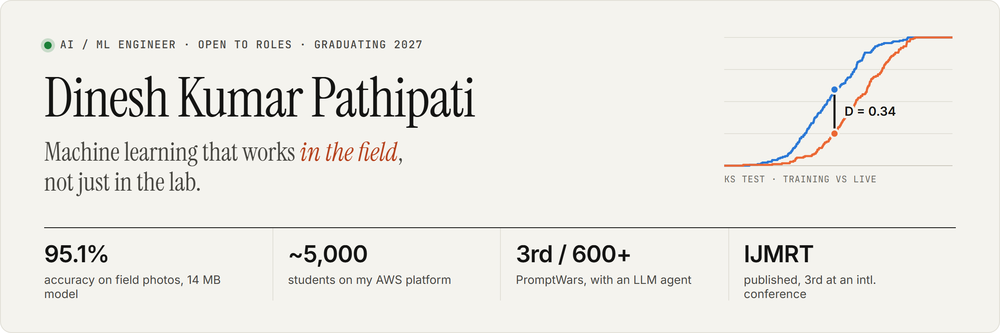

<a href="https://portfolio-one-flame-92.vercel.app">
  <picture>
    <source media="(prefers-color-scheme: dark)" srcset="assets/banner-dark.png">
    
  </picture>
</a>

Final-year Data Science student at RGMCET, open to **AI Engineer** and **ML Engineer** roles (graduating 2027). I like the part of machine learning that happens after the notebook: evaluating on realistic data, serving inside latency and quota budgets, and noticing when production drifts away from the training set.

**[Portfolio](https://portfolio-one-flame-92.vercel.app)** · **[Résumé](https://portfolio-one-flame-92.vercel.app/Dinesh_Kumar_Resume.pdf)** · **[LinkedIn](https://www.linkedin.com/in/dinesh-kumar-pathipati)** · **[Email](mailto:dineshkumarpathipati@gmail.com)**

### Selected work

**[Crop disease detection that holds up on field photos](https://github.com/Dinesh-kumar9/crop-disease-prediction)** · [live demo](https://crop-disease-identification.onrender.com/) 
MobileNetV2 transfer learning reaching **95.1% accuracy and 0.95 weighted F1** on field-condition banana leaves (BananaLSD), from a **14 MB** model. A Flask pipeline adds weather-aware field scheduling, yield-loss estimates in ₹, and spoken advice in 10 languages. Published in IJMRT; 3rd place at an international student conference. 
TensorFlow · Keras · Flask · OpenWeatherMap

**[Reel Intelligence: an LLM agent that reads intent, not keywords](https://github.com/Dinesh-kumar9/Hack2skill_Challenge)** · [live demo](https://reel-intelligence-omega.vercel.app) 
Infers a student’s real interests from their Reel history and recommends hype-free learning content. I collapsed 10 Gemini calls into **1 structured call** (90% less quota, inside Vercel’s 60 s limit), with API-key failover on 429/503 and 21 tests in CI. **3rd of 600+ at PromptWars** (92.78 / 100). 
Node.js · Gemini API · Vercel · GitHub Actions

**RGMCET Eduflow** · [live site](https://d1r0k8fn16z5du.cloudfront.net/) 
A class project taken to production: a serverless AWS platform now used by **~5,000 students** and 30–40 faculty. CloudFront and S3, Cognito sign-in, API Gateway → Lambda inside a VPC, and RDS Proxy → PostgreSQL. 
AWS · Prisma

**[MLOps observability platform](https://github.com/Dinesh-kumar9/Drift_Detection)** · *in progress* 
Goal: say *which* pipeline stage caused drift, not just that drift happened. Phase 1 is shipped: schema-checked ingestion with baseline statistics, parallel Random Forest / XGBoost / Logistic Regression training on Celery, a staging → production registry, and a serving API that logs every prediction (52 unit tests). Next: KS and ADWIN stage monitors with root-cause attribution. 
FastAPI · Celery · Redis · PostgreSQL · XGBoost · Docker · Terraform

**[Smart Queue](https://github.com/Dinesh-kumar9/smrtqueue)** · [live demo](https://smrtqueue.vercel.app/) 
A real-time queue with priority ordering and a wait-time model that retrains itself after every 3 people served. 
Flask · Socket.IO · Supabase · scikit-learn

### Toolkit

**Modeling** · TensorFlow, Keras, scikit-learn, XGBoost, NumPy 
**LLM apps** · Gemini API, structured outputs, prompt design 
**Serving** · FastAPI, Flask, Celery, Redis 
**Cloud** · AWS (Lambda, API Gateway, RDS, S3, CloudFront, Cognito, VPC, IAM), Docker, Terraform, GitHub Actions

AWS Certified AI Practitioner · DataCamp Associate Data Analyst · 1st place in 3 RGMCET hackathons
