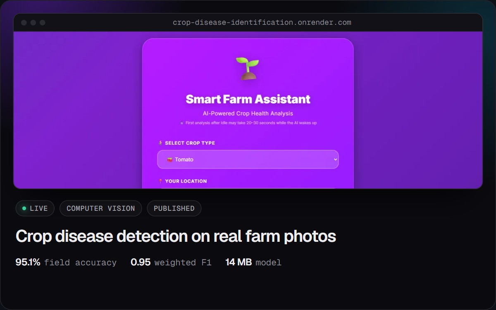
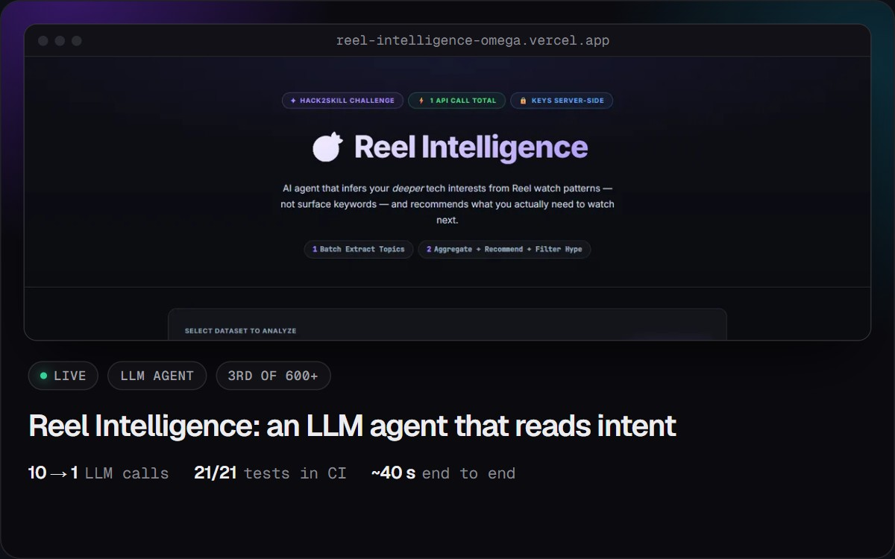
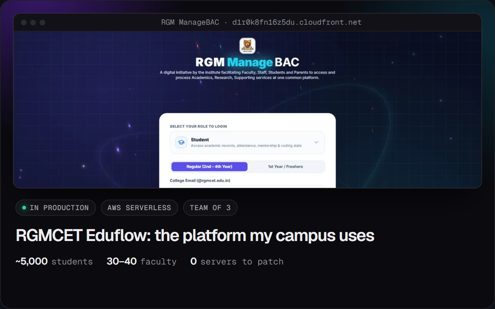
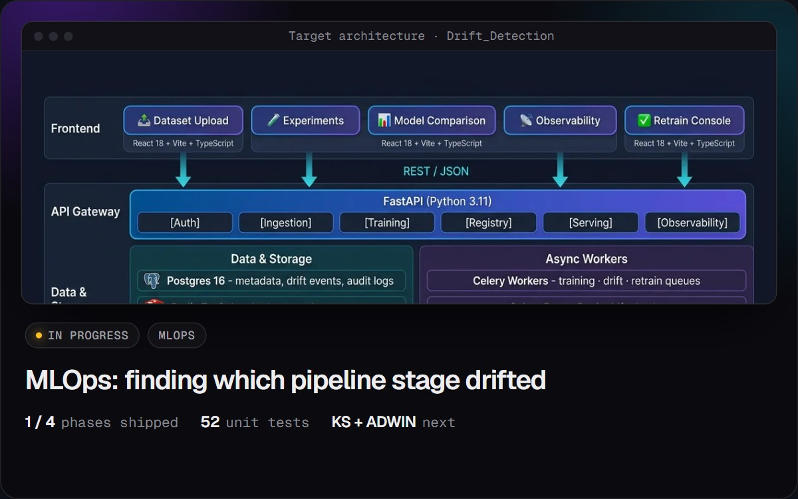
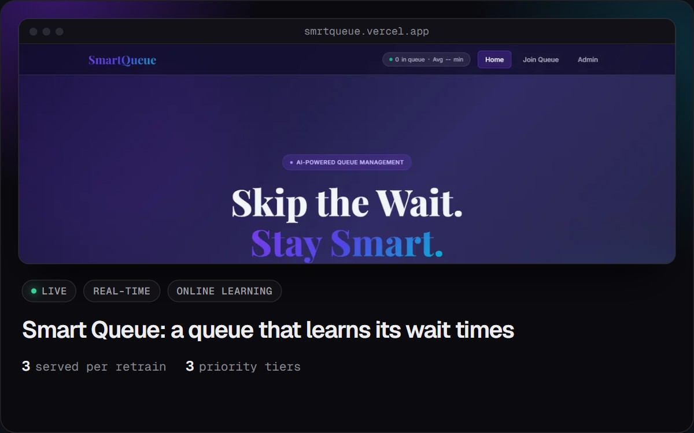
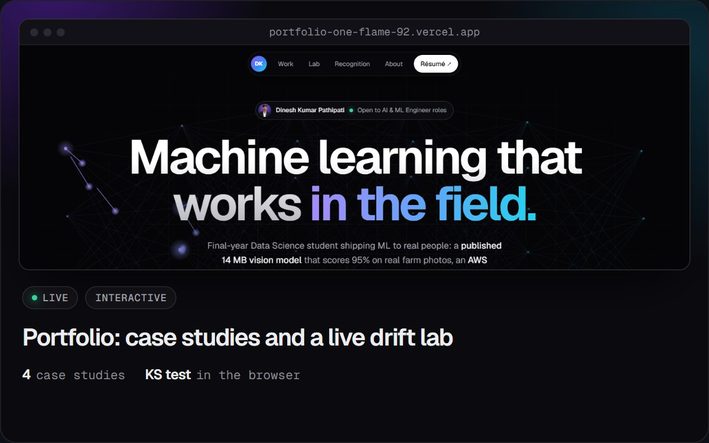

<a href="https://portfolio-one-flame-92.vercel.app"></a>


<p align="center">
  <a href="https://portfolio-one-flame-92.vercel.app"></a>
  <a href="https://portfolio-one-flame-92.vercel.app/Dinesh_Kumar_Resume.pdf"></a>
  <a href="https://www.linkedin.com/in/dinesh-kumar-pathipati"></a>
  <a href="mailto:dineshkumarpathipati@gmail.com"></a>
</p>

### 🧠 About me

```python
class Dinesh:
    role      = "AI / ML Engineer"
    education = "B.Tech Data Science · RGMCET, Nandyal · graduating 2027 · CGPA 8.52"
    focus     = ["computer vision", "LLM agents", "MLOps & drift detection"]
    shipped   = {"field_accuracy": "95.1%", "students_served": "~5,000", "promptwars": "3rd / 600+"}
    open_to   = ["AI Engineer", "ML Engineer"]
    say_hi    = "dineshkumarpathipati@gmail.com"
```

### 🚀 Featured work

<p align="center">
  <a href="https://github.com/Dinesh-kumar9/crop-disease-prediction"></a>
  <a href="https://github.com/Dinesh-kumar9/Hack2skill_Challenge"></a>
  <a href="https://d1r0k8fn16z5du.cloudfront.net/"></a>
  <a href="https://github.com/Dinesh-kumar9/Drift_Detection"></a>
  <a href="https://github.com/Dinesh-kumar9/smrtqueue"></a>
  <a href="https://portfolio-one-flame-92.vercel.app"></a>
</p>

<p align="center"><sub><b>Live demos:</b> <a href="https://crop-disease-identification.onrender.com/">crop disease</a> · <a href="https://reel-intelligence-omega.vercel.app">Reel Intelligence</a> · <a href="https://d1r0k8fn16z5du.cloudfront.net/">Eduflow</a> · <a href="https://smrtqueue.vercel.app/">Smart Queue</a> · <a href="https://portfolio-one-flame-92.vercel.app/#lab">drift lab</a></sub></p>

### 🧰 Tech stack

<p align="center">
  <br>
  
</p>

### 📈 On GitHub

<p align="center">
  
  
</p>

<picture>
  <source media="(prefers-color-scheme: dark)" srcset="https://raw.githubusercontent.com/Dinesh-kumar9/Dinesh-kumar9/output/github-snake-dark.svg">
  
</picture>

### 🏆 Recognition

- 🥉 **3rd of 600+** at PromptWars (Hack2Skill) with Reel Intelligence, scored 92.78 / 100
- 📄 **Published in IJMRT**; 3rd place at the Students International Conference 2026, JAIN University
- 🏆 **1st place × 3** in hackathons run by RGMCET technical clubs
- ☁️ **AWS Certified AI Practitioner** · DataCamp Associate Data Analyst · AWS Academy Cloud Foundations & Architecting

<p align="center"><sub>The header, typing terminal and cards are hand-built SVGs in this repo. The activity cards and snake refresh daily with GitHub Actions.</sub></p>
